# PCM/DSD VU v1.0.0 — Official User Manual

> **Official user manual · October 23, 2026 · Windows x86/x64 / foobar2000**  
> Based on 30 user-supplied screenshots and the x86/x64 Release build record. The installed component is confirmed as `PCM/DSD VU 1.0.0` in foobar2000 Components.

## 1. Overview

**PCM/DSD VU** is a VU meter visualization component for foobar2000. The supplied screenshots confirm a standalone meter window, left/right meters, needle imagery and skins, and context-menu settings.

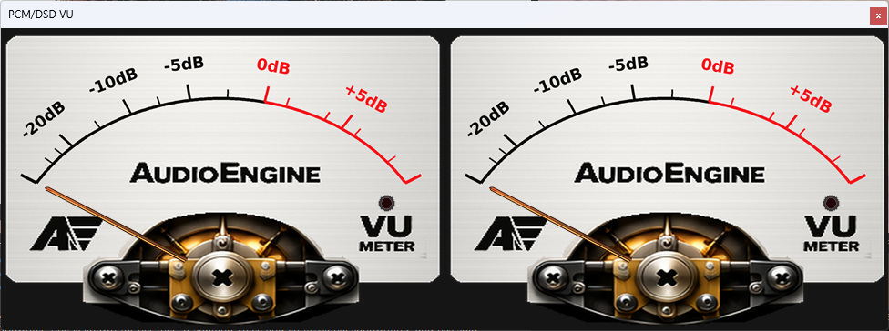

*Figure 1. Standalone meter in the AUDIOENGINE appearance.*

The isolated x64 Release build completed with MSVC v145 on October 23, 2026 (zero build errors, ten warnings). DLL SHA256: `0088C468F54E2994FBC09DF4A811F89445C0F0CDA4FB46661CE9D148E33055CC`. The build and the installed-version screenshot are separate pieces of evidence.

## 2. Core capabilities — automatic PCM/DSD detection and full metering

### 2.1 DoP-aware format detection

**PCM/DSD VU interprets actual DoP (DSD over PCM) signals to detect PCM and DSD automatically.** Format detection is signal-based, not a manual selection inferred from file extensions or playlist names. PCM and DSD are both supported for the VU needle and level-display functions (confirmed by the project owner).

**DoP is a transport container, not a conversion of DSD audio into PCM audio.** DSD bits are carried inside PCM-format frames along with identification markers. The DoP open standard defines alternating identification markers `0x05` and `0xFA` for a commonly used DoP framing scheme. This describes the **standard**; it is not a claim that the VU component has been verified for every DoP variation, marker voting threshold, DSD rate, or native DSD input route.

- Automatic detection from actual DoP signals; no manual PCM/DSD mode selection required
- Full VU meter operation for **both PCM and DSD signal formats** (project-owner confirmation)
- Separate PCM and DSD backgrounds in the external-skin assets
- No unverified claim of support for direct Native DSD input or all DSD multipliers

**Reference:** [DoP open Standard, Version 1.1](https://dsd-guide.com/sites/default/files/white-papers/DoP_openStandard_1v1.pdf)

### 2.2 Level measurement and presentation controls

The VU level-display mode can be selected as `RMS + Peak`, `RMS`, or `Peak`. The contextual display options also include `Show Crest Factor` and `Show LUFS / LRA`. In general audio terminology, **crest factor** is the difference between peak and RMS level, **LUFS** describes measured loudness, and **LRA** describes variation in loudness. These descriptions are explanatory, not claims of a particular measurement formula or verified EBU R128 compliance in this component.

Level display, automatic PCM/DSD format detection, and visual needle ballistics are different parts of the product and should not be conflated.

**Reference:** [EBU R128](https://tech.ebu.ch/docs/r/r128v4_0.pdf)

## 3. Opening the meter

In foobar2000, select **View → Visualizations → PCM/DSD VU**.

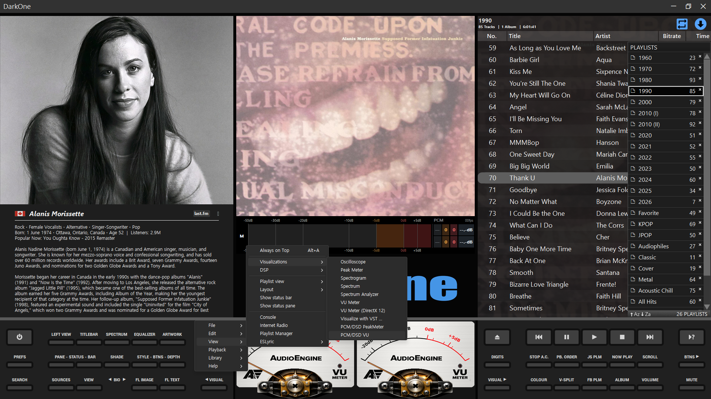

*Figure 2. Launch path in the user's DarkOne interface.*

Right-click in the standalone meter to access its settings. Check marks described below are **as captured**, not asserted factory defaults.

## 4. Context menu

### 4.1 Layout

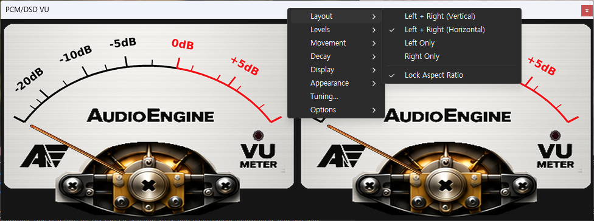

The menu contains `Left + Right (Vertical)`, `Left + Right (Horizontal)`, `Left Only`, `Right Only`, and `Lock Aspect Ratio`. In the screenshot, **Left + Right (Horizontal)** and **Lock Aspect Ratio** are checked. The menu offers orientation and channel display choices; the screenshots do not demonstrate each resulting layout.

### 4.2 Levels

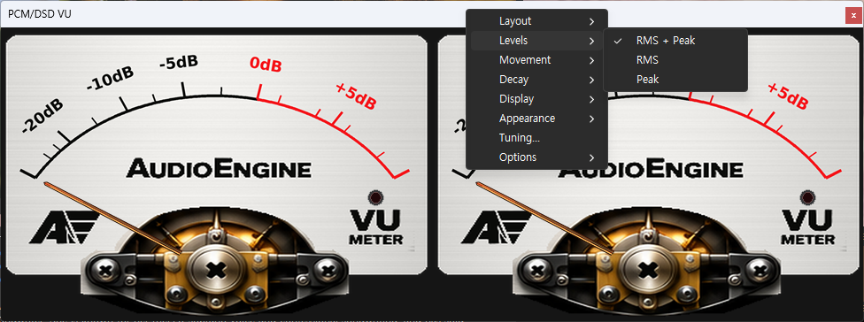

Available selections are `RMS + Peak` (**checked**), `RMS`, and `Peak`. The screenshot establishes the available modes, not the RMS integration interval or underlying metering algorithms.

### 4.3 Movement

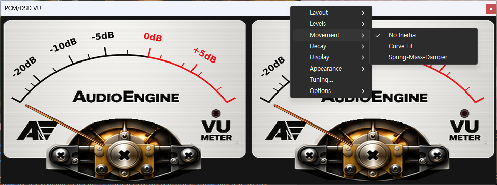

The available modes are `No Inertia` (**checked**), `Curve Fit`, and `Spring-Mass-Damper`. No unverified quantitative behavior is claimed for these modes.

### 4.4 Decay

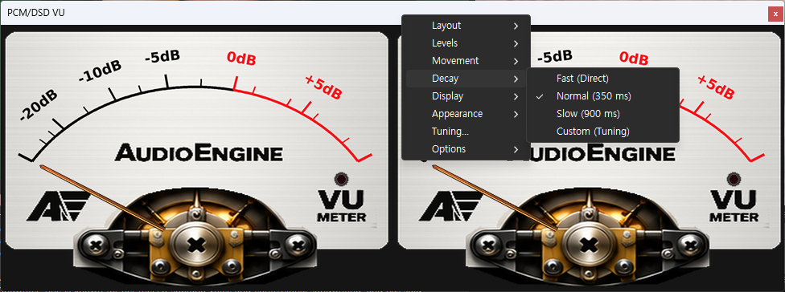

`Fast (Direct)`, `Normal (350 ms)` (**checked**), `Slow (900 ms)`, and `Custom (Tuning)` appear in the menu. Millisecond labels are reproduced exactly as shown.

### 4.5 Display

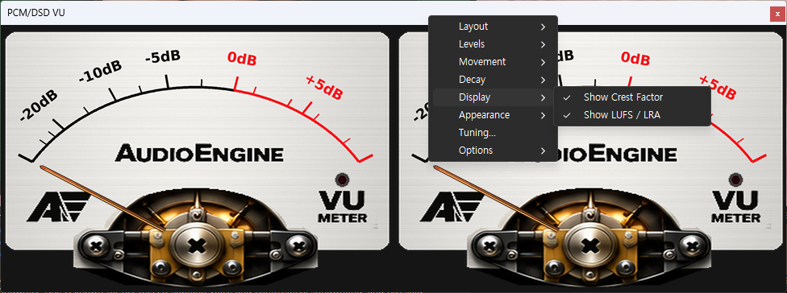

`Show Crest Factor` and `Show LUFS / LRA` are both **checked** in the screenshot. Actual readouts appear in the Bar/Analog/Digital captures below. Numerical algorithms and compliance are separate validation questions.

### 4.6 Appearance

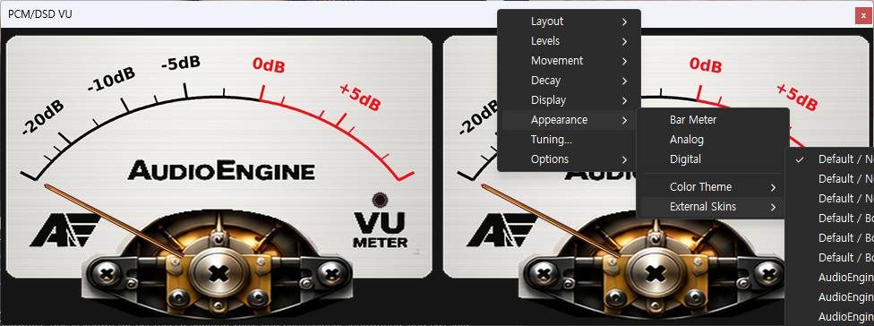

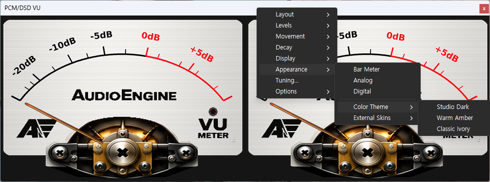

The menu exposes `Bar Meter`, `Analog`, `Digital`, `Color Theme`, and `External Skins`. The visible color themes are `Studio Dark`, `Warm Amber`, and `Classic Ivory`. The full External Skins submenu is clipped in the screenshot, so the complete list is not fabricated here.

The STEP25 file inventory establishes the exact resource arrangement:

| Dimension | Values | Count |
|---|---|---:|
| Design families | `Default`, `AudioEngine`, `ClassicStereo`, `StudioBlack` | 4 |
| Frame options | `None`, `Border` | 2 |
| Geometry | `Circle`, `Square`, `Half` | 3 |
| Skin profiles | 4 × 2 × 3 (`.vusk`) | **24** |
| PCM/DSD backgrounds | One PCM and one DSD PNG per profile | **48 PNGs** |
| Needle resources | One PNG per skin profile | 24 |
| Auxiliary images | Clear Full / Half | 2 |

**48 is the number of format-specific background images, not the number of distinct `.vusk` profiles.** The graphics use FULL (1936 × 1292) and HALF (1936 × 644) source-image formats. These are asset specifications, not fixed window dimensions.

### Captured external-skin examples

| Family | Unframed | Framed |
|---|---|---|
| Default silver | [Base example](images/v100/meter_standalone.png) | 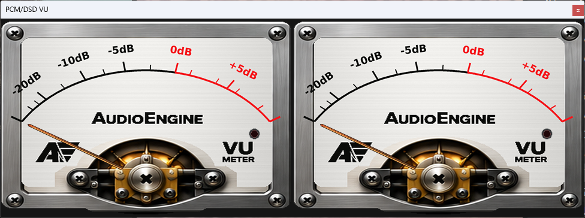 |
| AudioEngine amber | 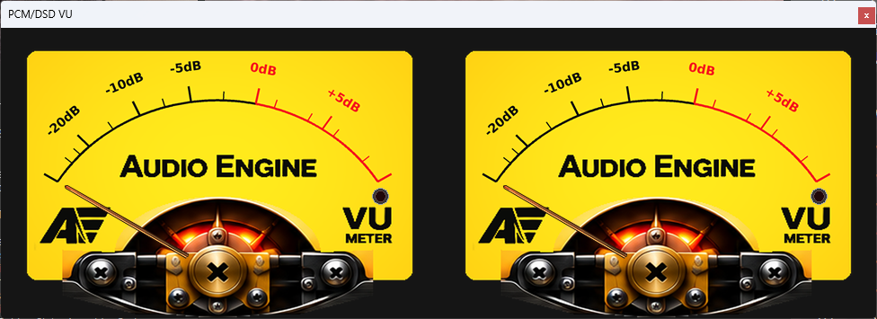 | 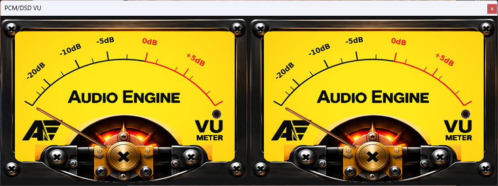 |
| Classic Stereo | 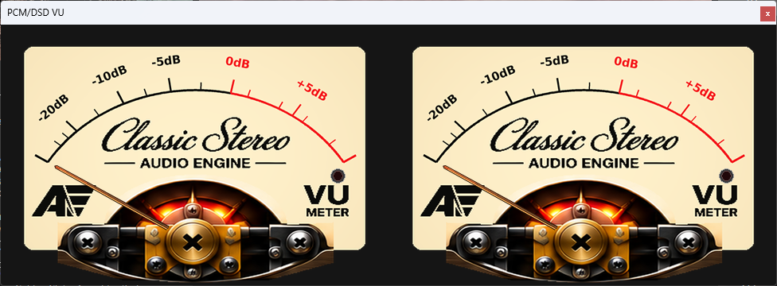 | 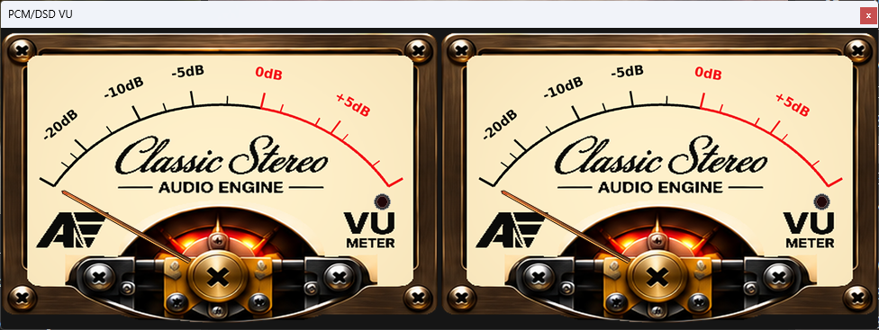 |
| Studio Black | 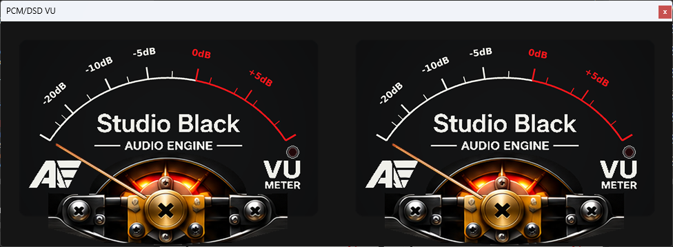 | 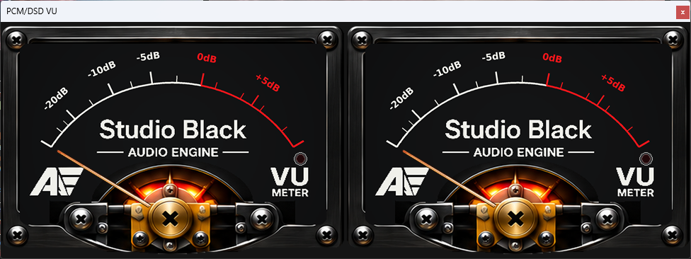 |

*Figures 11–17. User-provided captures. These samples do not demonstrate all Circle/Square/Half geometry options.*

### 4.7 Tuning

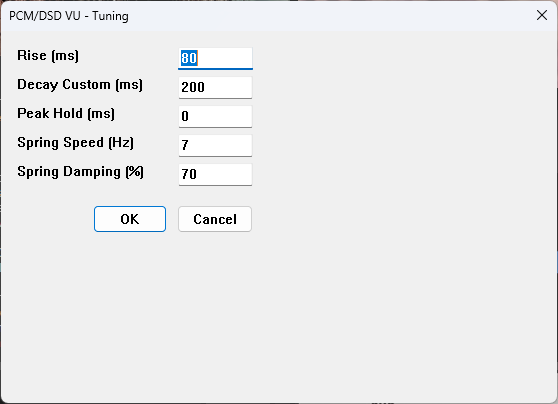

| Field | Value in screenshot | Unit |
|---|---:|---|
| `Rise` | 80 | ms |
| `Decay Custom` | 200 | ms |
| `Peak Hold` | 0 | ms |
| `Spring Speed` | 7 | Hz |
| `Spring Damping` | 70 | % |

The dialog has `OK` and `Cancel` buttons. These are **captured settings**, not asserted defaults, recommendations, or validated parameter ranges.

### 4.8 Options

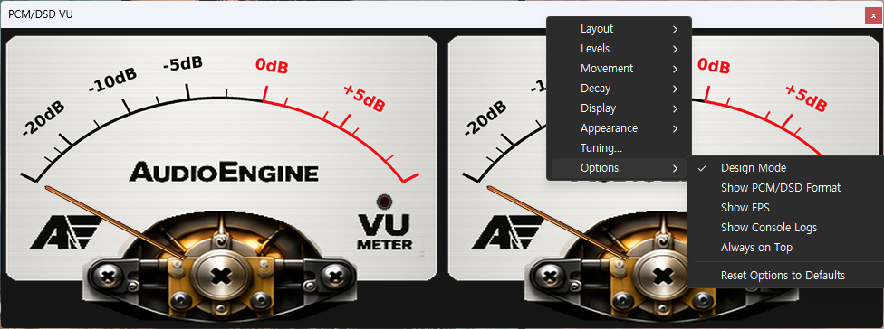

The menu contains `Design Mode` (**checked**), `Show PCM/DSD Format`, `Show FPS`, `Show Console Logs`, `Always on Top`, and `Reset Options to Defaults`. The remaining toggle entries do not show check marks in the image. The reset scope has not been verified.

## 5. Bar Meter / Analog / Digital — actual meter captures

These nine user-provided screenshots show **three color themes × three meter presentations** selected from `Appearance`.

| Theme / 테마 | Bar Meter | Analog | Digital |
|---|---|---|---|
| Studio Dark | 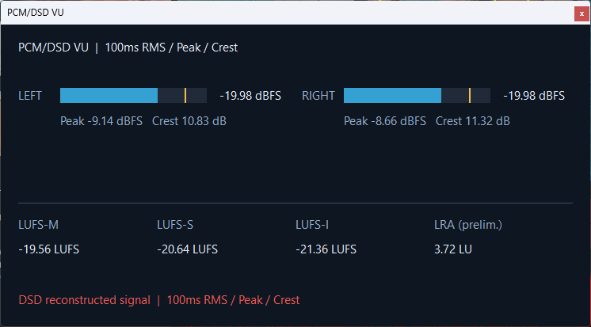 | 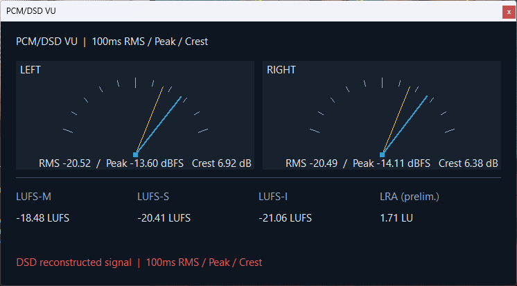 | 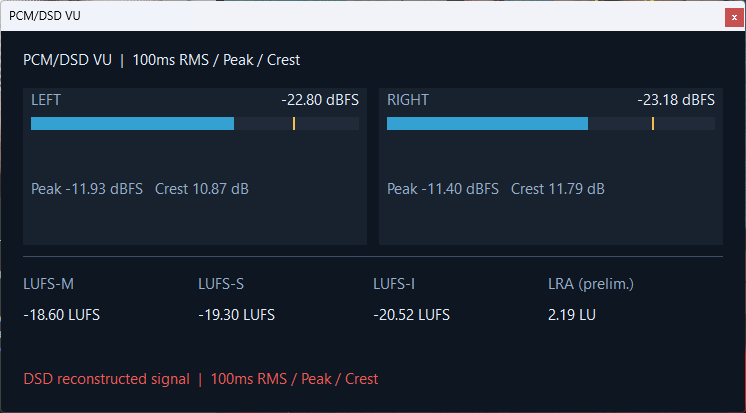 |
| Warm Amber | 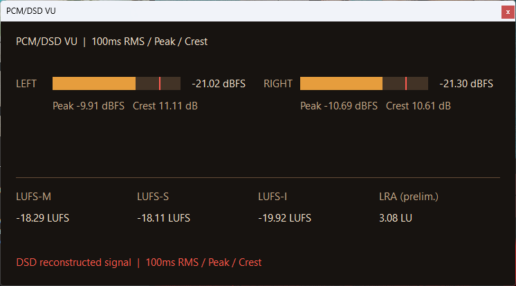 | 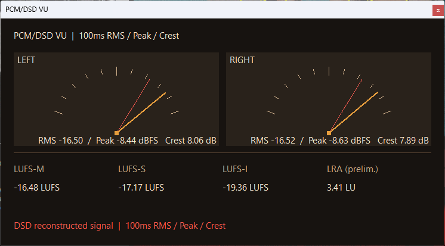 | 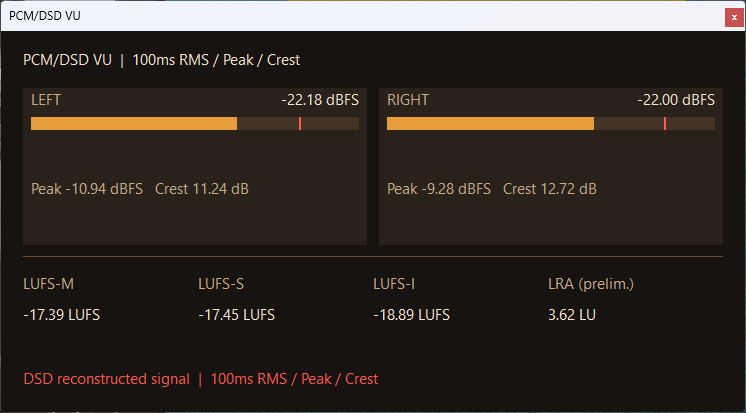 |
| Classic Ivory | 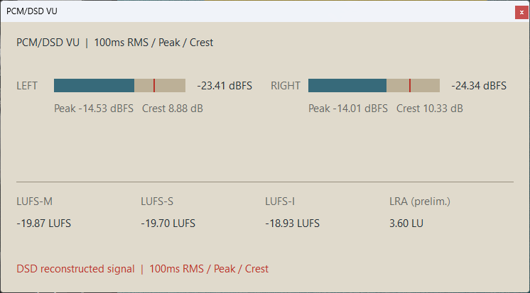 | 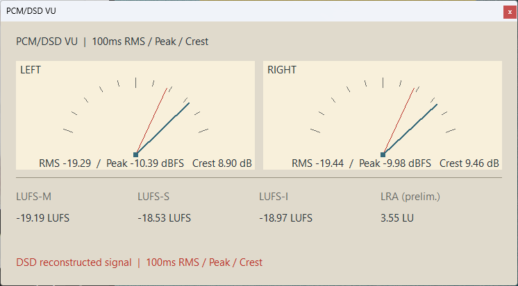 | 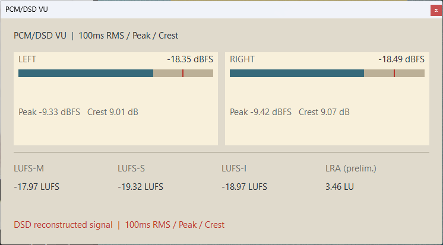 |

The screenshots show per-channel `RMS`, `Peak`, and `Crest`, together with `LUFS-M`, `LUFS-S`, `LUFS-I`, and `LRA (prelim.)`. The header says **100ms RMS / Peak / Crest** and the footer reads **DSD reconstructed signal**. The latter is a **metering-screen signal label**, not evidence that the playback output was converted to PCM. The word **prelim.** is retained because LRA is explicitly labeled preliminary in the application.

Readout values are examples from the user's listening session, not accuracy calibration or normative compliance evidence. These captures illustrate visible display modes and themes.

## 6. Practical settings by goal

| Goal | Menu | Options |
|---|---|---|
| Show both channels | Layout | Left + Right (Horizontal / Vertical) |
| Show a single channel | Layout | Left Only / Right Only |
| Preserve aspect ratio while resizing | Layout | Lock Aspect Ratio |
| Choose level display | Levels | RMS + Peak / RMS / Peak |
| Change needle behavior | Movement | No Inertia / Curve Fit / Spring-Mass-Damper |
| Choose release speed | Decay | Fast / Normal (350 ms) / Slow (900 ms) / Custom |
| Tune response | Tuning | Rise, Decay Custom, Peak Hold, Spring Speed, Spring Damping |
| Enable format/diagnostic indicators | Options | Show PCM/DSD Format / Show FPS / Show Console Logs |
| Window controls | Options | Always on Top / Design Mode / Reset Options to Defaults |

The screenshot check marks reflect the captured session; they are not presented as application-wide factory defaults.

**Format-sensitive artwork:** PCM and DSD backgrounds are separate assets. The project design specifies red-zone thresholds starting at 0 dB for PCM and +3.1 dB for DSD; a live screenshot of both thresholds switching is still pending.

## 7. Build artifacts (build-verified)

### x86 (32-bit) build and playback confirmation

On October 23, 2026, the Win32 x86 Release build passed MSVC v145 (0 errors, 10 warnings). DLL SHA256: `1C8E5C9D9CEAB8BA84AD162FB200A14E3DFC5C0FDC35549395813226C1AB109D`. Both the `.fb2k-component` and onedir ZIP passed the 99-file check (one DLL and 98 resources each).

The component was installed and opened in **foobar2000 2.25.8 x86** with version `PCM/DSD VU 1.0.0`. The project owner personally verified normal operation during PCM and DoP/DSD playback.

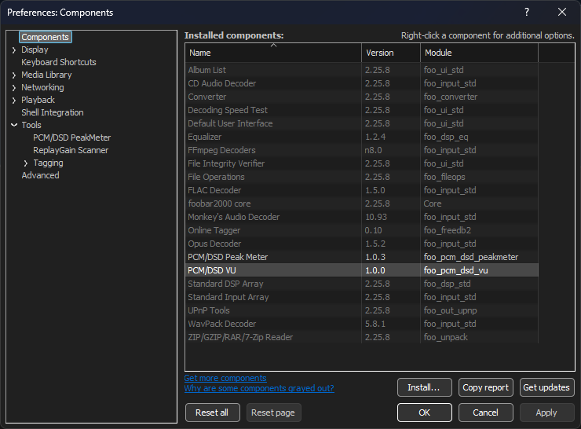

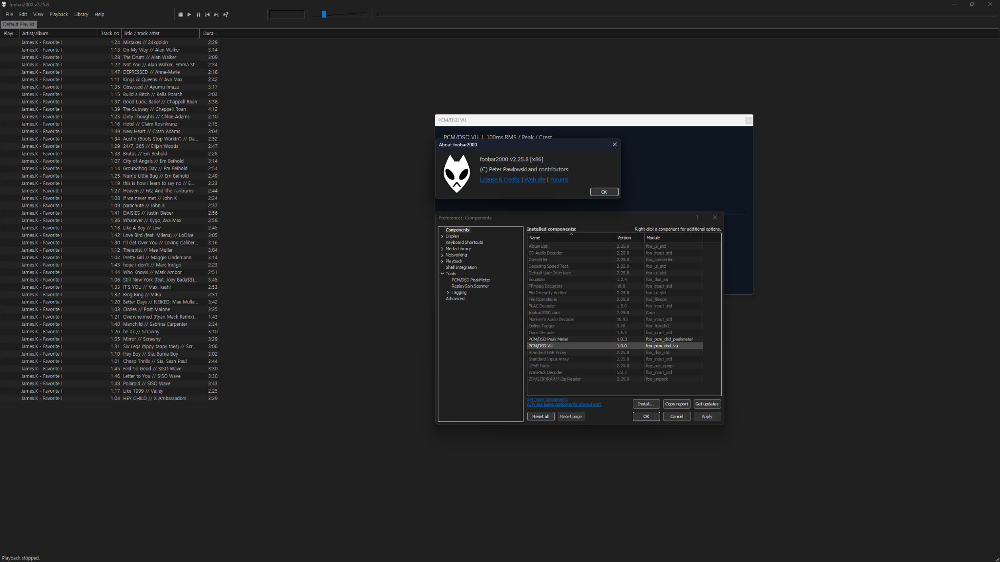

The October 23 builds produced separate native x86 and x64 packages; select the one matching your foobar2000 architecture:

- `foo_pcm_dsd_vu.dll` — x64, 226,304 bytes.
- `foo_pcm_dsd_vu_v1.0.0_x64.fb2k-component` — 99 files: the DLL and 98 resources.
- `PCM_DSD_VU_v1.0.0_x64.zip` — onedir multi-file archive of the same 99 files.
- `foo_pcm_dsd_vu_v1.0.0_x86.fb2k-component` — x86 component package containing 99 files.
- `PCM_DSD_VU_v1.0.0_x86.zip` — x86 onedir multi-file archive, 99 files.

**Installation check:** exit foobar2000, install the `.fb2k-component`, restart, and confirm `PCM/DSD VU` / `1.0.0` under `Preferences → Components`. The project owner supplied an actual screenshot showing this.

### Installed version confirmation

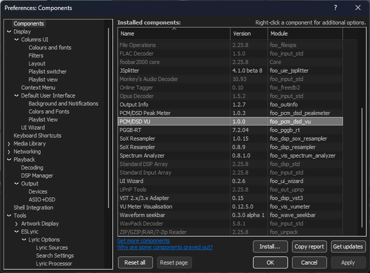

*Figure. Actual capture of the foobar2000 2.25.8 Components list, showing `PCM/DSD VU`, version `1.0.0`, and module `foo_pcm_dsd_vu`.*

## 8. Installation checks and troubleshooting

- **Components still shows an older beta:** verify which foobar2000 installation loaded the component, fully exit and restart after installing v1.0.0.
- **No PCM/DSD VU menu item:** inspect the installed `foo_pcm_dsd_vu` component in the same foobar2000 instance before changing anything else.
- **Need to see the format:** enable `Options → Show PCM/DSD Format`. A hidden format label does not by itself indicate failed signal detection.
- **Needles are not moving:** first check that audio is playing and a captured signal is reaching the meter; inspect Design Mode and current display/movement settings. These are ordinary checks, not a confirmed diagnosis of a particular fault.
- **Multiple portable installations:** verify in the TEST installation before applying any package to daily-use foobar2000.

## 9. Verification scope and limitations

- **Installed version:** `1.0.0` captured and confirmed in the Components dialog.
- **Meters:** live numerical readouts for RMS, Peak, Crest, LUFS-M/S/I, and LRA (prelim.) are captured. The format/FPS toggles are documented separately.
- The 24 `.vusk` profiles and 48 PCM/DSD background PNGs are confirmed from the STEP25 file list. Not every submenu label/order is visible in the captured menu.
- Source/runtime substantiation for measurement formulas, direct Native DSD support, supported sample rates and DSD multipliers, DSP/output-stream noninterference, setting persistence, and unverified platforms.

**Scope:** real UI examples and project-owner-confirmed core capabilities. Unverified technical implementation limits are not asserted.
